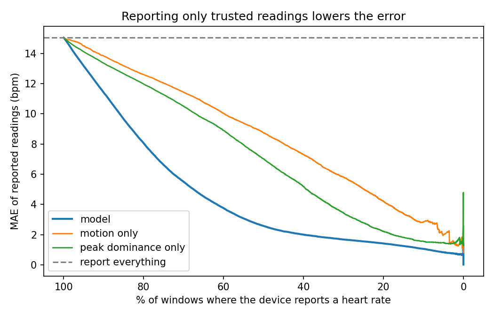
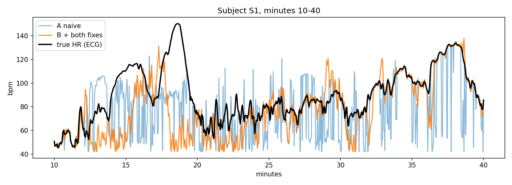
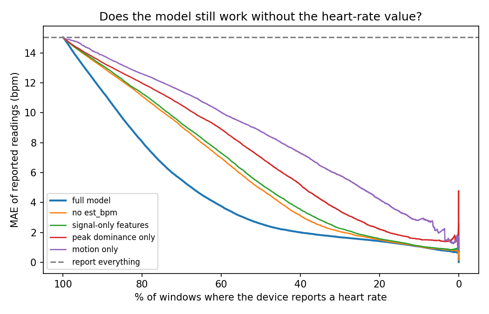
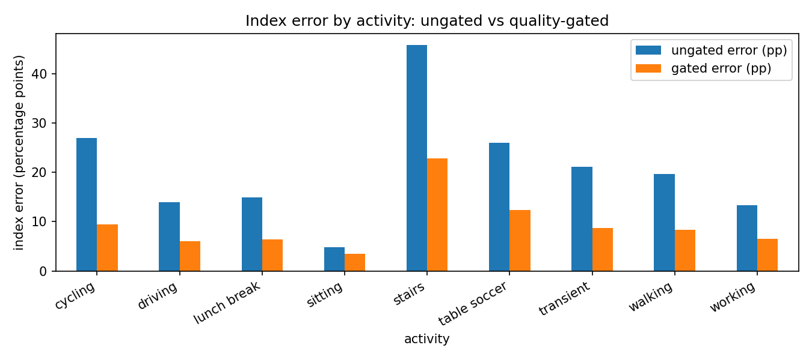

# Knowing when not to trust a wrist-PPG heart-rate reading

A small, reproducible study on the public **PPG-DaLiA** dataset. It asks two questions:

1. How well can a simple motion-aware estimator read heart rate from a wrist PPG sensor while
   the wearer moves?
2. Can a **signal-quality gate** (a model that decides "show this reading" or "withhold it")
   trade coverage for accuracy, including for a **baseline-normalized score**, where one bad
   reading corrupts both today's value and the baseline later values are compared against?

> **Scope.** The data is wrist-worn, single-wavelength PPG with ECG ground truth. This is not a
> head-worn or brain-blood-flow study. The baseline-normalized part uses *heart rate* as a
> stand-in because it is the only quantity here with ground truth. Motion-artifact handling
> for wrist PPG is well studied (e.g. TROIKA, Zhang et al., IEEE TBME 2015); this project is a
> careful end-to-end evaluation of a quality gate, not a new estimation method.

## Key results

| | Result |
|---|---|
| The motion problem (naive estimator, all 15 subjects) | MAE **2.7 bpm** sitting vs **27.9** cycling vs **36.3** on stairs |
| Final estimator, held-out subjects S9-S15 | MAE **13.4 bpm** (naive: 15.5); cycling 27.4 → 13.5 |
| Quality gate, reading shown in 70% of windows | MAE **15.04 → 5.50 bpm** (S9-S15 only: 13.44 → 4.46) |
| Same gate, reading shown in 50% of windows | MAE **2.58 bpm** (S9-S15: 2.17) |
| Gate using signal features only (no heart-rate value) | MAE **9.27 bpm** at 70% shown |
| Baseline-normalized index (heart-rate stand-in), ~70% shown | Index error **18.5 → 7.6 percentage points** |

About 70% of the gate's advantage over the best single-feature score comes from the estimate's
own value (a "plausible heart rate" prior) rather than from signal features alone. Both numbers
are reported on purpose.



## Notebooks (run in this order)

| Notebook | What it does | Main outputs in `results/` |
|---|---|---|
| `01_baseline.ipynb` | Loads data, cuts 8 s windows (2 s step), builds a naive spectral-peak estimator (A) and a motion-aware one (B), shows where motion breaks them | `01_mae_by_activity.csv`, `01_chart_*.png` |
| `02_fixes.ipynb` | Tries two fixes (motion threshold, narrow search around the previous estimate), tuned on S1-S8 and reported on S9-S15 | `02_ablation_test_subjects.csv`, `02_sweep_*.csv`, `02_chart_*.png` |
| `03_signal_quality.ipynb` | Trains the quality model (leave-one-subject-out), risk-coverage analysis, feature importance, feature ablation | `03_auc.csv`, `03_risk_coverage_*.csv`, `03_ablation_features.csv`, `03_chart_*.png`, `03_window_predictions.csv` |
| `04_index_demo.ipynb` | Baseline-normalized index (heart-rate stand-in) with and without the quality gate | `04_index_error*.csv`, `04_chart_*.png` |

## Data

PPG-DaLiA: 15 subjects, wrist PPG at 64 Hz and accelerometer at 32 Hz, ECG-derived heart rate as
ground truth, daily activities including cycling, walking and stairs. CC BY 4.0. **Not included
in this repo**; download it from the UCI repository
(https://archive.ics.uci.edu/dataset/495/ppg+dalia).

## Method

1. **Estimator.** Bandpass 0.5-4 Hz, then the strongest FFT peak per 8 s window. The PPG spectrum
   is turned down where the accelerometer spectrum is loud, weighted by how much the person is
   moving. The search is restricted to +/-10 bpm around the previous estimate, with a reset to a
   full search after 5 weak windows in a row (10 s).
2. **Quality model.** Predicts whether a window's estimate is within 10 bpm of the ECG heart rate,
   from 11 features that need no ECG: peak dominance, peak vs background, runner-up peak ratio,
   accelerometer loudness at the chosen frequency, motion level, wrist-movement energy, jump from
   the previous estimate, recent wobble, the estimate itself, and two tracker-confidence values.
   Gradient boosting (scikit-learn), **leave-one-subject-out** evaluation.
3. **Index demo.** `index = (HR / baseline - 1) x 100`, where the baseline is the median of the
   previous 10 minutes. Compared with the ECG version, with and without the gate; the gated
   pipeline builds its baseline only from trusted windows.

Estimator settings were chosen on S1-S8 only, so S9-S15 are reported separately wherever it matters.

## Results

### Estimator (S9-S15, not used for tuning)

| Method | MAE (bpm) | Windows with error > 20 bpm |
|---|---|---|
| A. Naive spectral peak | 15.50 | 29.5% |
| B. + motion-aware suppression | 14.46 | 26.9% |
| B + narrow search (final) | 13.44 | 25.0% |

By activity (A → final): cycling 27.4 → 13.5, walking 25.5 → 20.7, sitting 2.05 → 1.76,
stairs 34.3 → 34.1 (no real change). Without the "transient" windows (activity changing), the final
estimator's MAE is 11.74 bpm.



### Quality gate: error vs how often a reading is shown (MAE, bpm)

| Share of windows shown | Gate (model) | Motion only | Peak clarity only |
|---|---|---|---|
| 100% (all subjects) | 15.04 | 15.04 | 15.04 |
| 70% (all subjects) | **5.50** | 11.43 | 10.50 |
| 50% (all subjects) | **2.58** | 8.74 | 7.02 |
| 70% (S9-S15) | **4.46** | 9.87 | 9.18 |
| 50% (S9-S15) | **2.17** | 7.42 | 6.24 |

Pooled AUC for "is this reading within 10 bpm?": model 0.954 (median per person 0.969), peak clarity
0.816, motion only 0.708. At 70% shown, windows with error above 20 bpm fall from 26.9% to 6.4%
(all subjects).

### Ablation: what is the gate actually using?

| Variant | AUC | MAE @70% (all) | MAE @70% (S9-S15) |
|---|---|---|---|
| full model | 0.954 | 5.50 | 4.46 |
| without the heart-rate value | 0.873 | 9.06 | 7.81 |
| signal features only | 0.851 | 9.27 | 7.94 |
| peak clarity only | 0.816 | 10.50 | 9.18 |
| motion only | 0.708 | 11.43 | 9.87 |

Signal features alone still beat the simple scores (roughly 12-19% lower error), but most of the
full model's edge comes from knowing which heart-rate values are plausible. I did not determine
whether that reflects the estimator's typical failure values or exercise intensity.



### Baseline-normalized index (heart-rate stand-in)

| Target share shown | Windows with an index | Mean error (pp) | Median (pp) | Windows off by > 20 pp |
|---|---|---|---|---|
| 100% (no gate) | 99.3% | 18.49 | 9.11 | 31.8% |
| 80% | 79.3% | 10.30 | 4.61 | 15.8% |
| 70% | 69.3% | 7.61 | 3.69 | 9.6% |
| 50% | 48.4% | 5.05 | 2.85 | 3.5% |

By activity at ~70% (ungated → gated error, share of windows still shown): cycling 27.0 → 9.5 (77%),
walking 19.7 → 8.3 (63%), stairs 45.8 → 22.8 (47%), table soccer 26.0 → 12.4 (41%),
sitting 4.8 → 3.5 (88%).



## What did not work

- **Motion threshold** (apply the motion suppression only above a motion level): no benefit; the best
  value was 0. I had guessed that suppression was hurting still windows (sitting went from 2.7 to
  3.2 bpm in notebook 1); this test did not support that explanation.
- **Narrow search window:** gains were unstable across widths on the dev subjects (+/-10 helped
  slightly, +/-15 and +/-20 hurt), so treat the improvement as modest.
- **Tracker-confidence features** (jump size, weak-window count) added almost nothing to the gate.

## Limitations

- Wrist, single-wavelength data; a temple-worn multi-wavelength sensor will behave differently.
- The gate trades coverage for accuracy: errors are measured on the windows that are shown, and the
  hardest ones (stairs, table soccer, the onset of intense effort) are withheld most. In the example
  index plot, the gate shows nothing during the steepest part of a hard effort.
- Offline, non-causal filtering (forward-backward), and the motion level is scaled using the whole
  recording. A real device would need causal versions of both.
- "Good" is defined as within 10 bpm, an arbitrary cut-off. The 70% / 50% operating points are
  picked from pooled out-of-fold predictions.
- Much of the gate's skill relies on the estimate's own value. The index demo uses the full gate and
  was not repeated with the signal-only gate.
- 15 subjects, one dataset, one study protocol. No embedded or real-time evaluation.
- The 10-minute median baseline is my own choice for illustration.

## Reproduce

```bash
git clone <this repo>
cd <this repo>
python -m venv .venv
# Windows: .venv\Scripts\activate      Mac/Linux: source .venv/bin/activate
pip install -r requirements.txt
```

1. Download PPG-DaLiA and unzip it into `data/` (any folder layout works; the notebooks search
   recursively for `S1.pkl` ... `S15.pkl`).
2. Open the notebooks in `notebooks/` and run them in order, with the notebook's own folder as the
   working directory (the default in Jupyter and VS Code). Notebook 4 reads a file written by
   notebook 3.
3. Runs on a laptop CPU, no GPU needed. The first pass over the spectra takes several minutes;
   notebooks 2 and 3 share a cache in `results/`, so later runs are faster. Delete the cache file
   if you change the data or the window settings.
4. **Dry run:** set `MAKE_FAKE = True` at the top of a notebook to run on synthetic data first. It
   writes to `dryrun/`, never to `results/`, and its numbers are meaningless.

```
.
├── notebooks/   01_baseline, 02_fixes, 03_signal_quality, 04_index_demo
├── results/     charts and tables written by the notebooks
├── data/        PPG-DaLiA goes here (not committed)
├── requirements.txt
└── LICENSE
```

## Possible extensions

- Repeat the index demo with the signal-only gate.
- Replace the non-causal filters and whole-recording motion scaling with causal versions.
- Test on a second dataset (for example the IEEE Signal Processing Cup 2015 recordings).
- Report quality-gate results at the operating point a product would need, and add a fallback for
  windows that are withheld during intense effort.
- Profile a compact version of the model for a microcontroller-class chip.

## References

- Reiss, Indlekofer, Schmidt, Van Laerhoven. *Deep PPG: Large-Scale Heart Rate Estimation with
  Convolutional Neural Networks.* Sensors 2019, 19(14). (PPG-DaLiA dataset.)
- Zhang, Pi, Liu. *TROIKA: A General Framework for Heart Rate Monitoring Using Wrist-Type
  Photoplethysmographic Signals During Intensive Physical Exercise.* IEEE TBME, 2015 (arXiv:1409.5181).

## License

MIT for the code. The dataset has its own license (CC BY 4.0).
